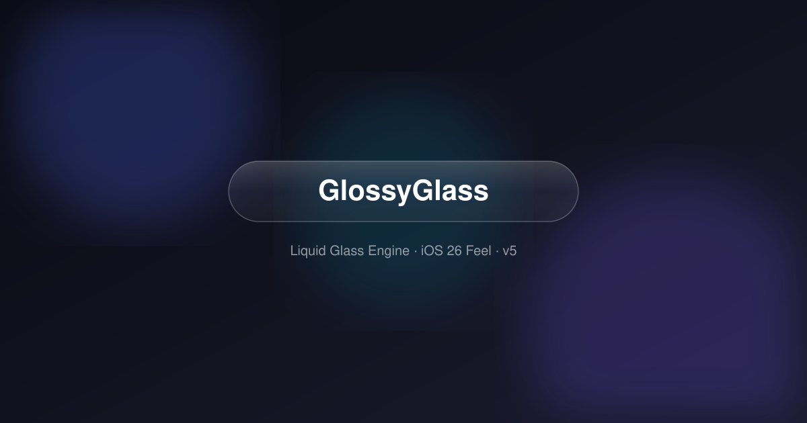

# GlossyGlass v5.3

<p align="center">
  
</p>

<p align="center">
  
  
  
</p>

**Full liquid-glass engine for Instagram**  
Pill tab · Nav · Feed · DMs · Reels · Stories · Profiles · Search · Notifications · Context menus

---

## Modes

| Mode | Feel |
|------|------|
| **Base (Glossy OFF)** | Clean iOS 26 liquid glass |
| **Glossy Mode ON** | Heavy GlossyGlass — tint, specular rim, top gloss, bloom |

---

## Coverage

- Tab bar → floating **pill capsule**
- Navigation bar → liquid strip
- Feed chrome & action bars
- DMs → composer + **circular call buttons**
- Reels / Stories / Profiles
- Search & Notifications surfaces
- Long-press / context menus
- Spring press animations
- **No floating overlays** — paints real views

---

## Access

Hold **Messages / Direct** for **1 second** → settings

---

## Install

1. **Actions** → Run **Build iOS dylib**
2. Download `GlossyGlass.dylib`
3. Inject (Ksign / Esign / Scarlet / Feather / Live Container)

---

## Architecture

```
Loader/          Bootstrap
Core/            Preferences · Material · Chrome · Animations · Ready · Effects
UI/              Settings · Icons
Instagram/       Locators · Hooks · DM · Reels · Profile · Feed · Search · Context
Public/          API v53
Assets/          Cover
```

**Version 5.3.0** · **API 53**
